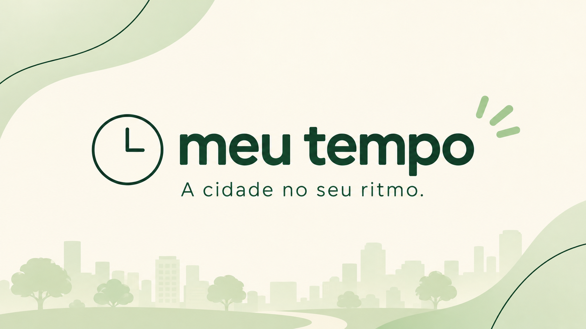
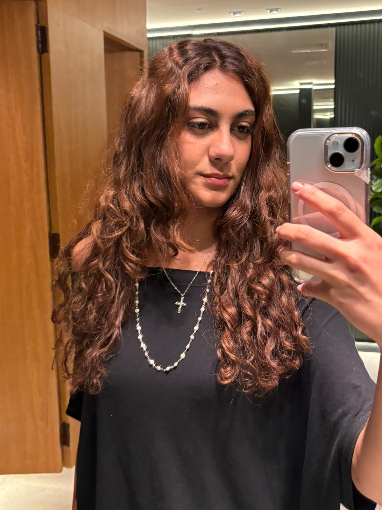

<div align="center">


<br>



<br><br>

# ⏱️ Meu Tempo | A cidade no seu ritmo.

### Um projeto que une tecnologia, acessibilidade e autonomia urbana.

**Nossa proposta nasce da escuta de pessoas com deficiência, pessoas idosas e pessoas com mobilidade reduzida, buscando soluções reais para tornar o deslocamento na cidade mais seguro e inclusivo.**

<br>


<br>


<br><br>

<a href="#-sobre-o-projeto">Sobre</a>
&nbsp;&nbsp;•&nbsp;&nbsp;
<a href="#-o-desafio">O Desafio</a>
&nbsp;&nbsp;•&nbsp;&nbsp;
<a href="#-nossa-proposta">Solução</a>
&nbsp;&nbsp;•&nbsp;&nbsp;
<a href="#-funcionalidades">Funcionalidades</a>
&nbsp;&nbsp;•&nbsp;&nbsp;
<a href="#-acessibilidade">Acessibilidade</a>
&nbsp;&nbsp;•&nbsp;&nbsp;
<a href="#-tecnologia">Tecnologia</a>
&nbsp;&nbsp;•&nbsp;&nbsp;
<a href="#-como-visualizar">Como Executar</a>
&nbsp;&nbsp;•&nbsp;&nbsp;
<a href="#-equipe">Equipe</a>

</div>

---

# 🔎 Sobre o projeto


<div align="justify">
O <b>Meu Tempo</b> é um protótipo web de mobilidade urbana acessível desenvolvido durante a <b>Global Solution 2026/2 da FIAP</b> (tema <i>CitizenTech</i> e alinhado à <b>ODS 11</b>).
A plataforma busca apoiar a autonomia de pessoas com deficiência, pessoas idosas e pessoas com mobilidade reduzida, conectando a jornada do cidadão na cidade a painéis operacionais de atendimento.

Durante o desenvolvimento, priorizamos ouvir usuários reais antes de desenhar as telas, entendendo onde o tempo urbano, a falta de previsibilidade e as barreiras físicas limitam o direito de ir e vir:
</div>

🚦 **Travessia semafórica assistida com tempo adicional**  
🚆 **Solicitação de apoio operacional em estações ferroviárias**  
🛠️ **Registro e acompanhamento de barreiras de zeladoria urbana**  
♿ **Controles visuais, sonoros e táteis adaptáveis no navegador**  
🤖 **Atalhos rápidos e orientação por voz com a assistente IARA**  
📊 **Painéis administrativos para gestão de chamados e ocorrências**

<br clear="right">

> **ℹ️ Escopo do repositório:** O conteúdo entregue neste projeto é uma **aplicação front-end demonstrativa**. Todos os cadastros, pedidos, sessões e interações operacionais são simulados localmente no navegador (`localStorage` e `sessionStorage`), sem servidor de aplicação ou banco de dados externo nesta entrega.

---

# 🧩 O desafio

<div align="center">

<table>
<tr>

<td align="center" width="20%">

<br><br>
<b>Tempo Curto</b>
<br>
<sub>Semáforos calculados apenas para quem caminha rápido.</sub>
</td>

<td align="center" width="20%">

<br><br>
<b>Barreiras Físicas</b>
<br>
<sub>Calçadas irregulares, buracos e falta de rampas.</sub>
</td>

<td align="center" width="20%">

<br><br>
<b>Transporte</b>
<br>
<sub>Elevadores parados e dificuldade no embarque sem apoio.</sub>
</td>

<td align="center" width="20%">

<br><br>
<b>Fricção Digital</b>
<br>
<sub>Interfaces complexas e pouco adaptadas para diferentes perfis.</sub>
</td>

<td align="center" width="20%">

<br><br>
<b>Gestão Urbana</b>
<br>
<sub>Falta de visibilidade integrada dos pontos críticos da cidade.</sub>
</td>

</tr>
</table>

</div>

<br>

<div align="justify">
A partir de entrevistas realizadas em campo com usuários reais (como pessoas cadeirantes, pessoas com deficiência visual e pessoas idosas), identificamos que os obstáculos urbanos se repetem todos os dias: sinais de pedestres que fecham rápido demais, elevadores interditados em estações de trem e metrô sem aviso prévio, e calçadas sem rampas ou piso tátil.
</div>

### 💭 O que passou a guiar nossa solução

> Como podemos oferecer mais tempo, previsibilidade e apoio para que pessoas com deficiência, pessoas idosas e pessoas com mobilidade reduzida circulem pela cidade no seu próprio ritmo?

Foi a partir dessa pergunta que nasceu o **Meu Tempo**.

---

# 💡 Nossa proposta

<div align="center">

A plataforma conecta duas pontas complementares: a **experiência acessível do cidadão** na rua e no transporte, e a **visão operacional das equipes** que atuam na cidade.

</div>

<br>

<table>
  <tr>
    <td width="50%" valign="top">
      <h3>👤 Para o Cidadão</h3>
      <p align="justify">
        Uma experiência simples, responsiva e adaptável para solicitar travessias com tempo estendido, pedir apoio de embarque em estações e relatar problemas de acessibilidade urbana, com feedback visual, sonoro e vibratório.
      </p>
      <ul>
        <li><b>Públicos:</b> Pessoas com deficiência (visual, física, auditiva, TEA), pessoas idosas e pessoas com mobilidade reduzida.</li>
        <li><b>Telas relacionadas:</b> <code>paginas/cadastro.html</code>, <code>paginas/login.html</code> e <code>paginas/app/</code>.</li>
      </ul>
    </td>
    <td width="50%" valign="top">
      <h3>🖥️ Para a Gestão Operacional</h3>
      <p align="justify">
        Painéis administrativos separados por perfil profissional para acompanhar chamados em tempo real, atualizar o status de elevadores e escadas rolantes, gerenciar ocorrências viárias e exportar relatórios.
      </p>
      <ul>
        <li><b>Perfis:</b> Transporte Ferroviário (Metrô/CPTM), Operação CET e Coordenação.</li>
        <li><b>Telas relacionadas:</b> <code>paginas/admin/login.html</code> e painéis em <code>paginas/admin/</code>.</li>
      </ul>
    </td>
  </tr>
</table>

---

# ✨ Funcionalidades

### 🌐 Portal Institucional
* **Apresentação completa:** Páginas de início, solução, sobre o projeto e equipe (`paginas/index.html`, `solucao.html`, `sobre.html`, `integrantes.html`);
* **Transparência e Suporte:** Páginas dedicadas a **Acessibilidade**, **Perguntas Frequentes (FAQ)**, **Contato**, **Política de Privacidade** e **Termos de Uso**.

### 📱 Experiência do Cidadão
* **Cadastro e Login Demonstrativo:** Fluxo com validações, configuração de preferências de acessibilidade e **PIN de 4 dígitos** (utilizando dados fictícios salvos no navegador);
* **Perfil e Documentos:** Consulta e edição de dados cadastrais e preferências, com prévia local de documentos fictícios;
* **Travessia Assistida:** Seleção de cruzamento em mapa esquemático, solicitação de travessia e tela de contagem regressiva com fases de espera e travessia, tempo adicional conforme as regras do protótipo, cancelamento e áudios sincronizados;
* **Apoio no Transporte:** Solicitação de acompanhamento em estações do catálogo demonstrativo, integrada localmente ao painel do transporte ferroviário;
* **Zeladoria Urbana & Meus Pedidos:** Registro demonstrativo de barreiras de acessibilidade na cidade e consulta do status de todas as solicitações realizadas.

### 🖥️ Área Profissional & Assistente IARA
* **Painéis por Perfil:** Telas dedicadas para **Transporte Ferroviário**, **Operação CET**, **Coordenação** (com revisão/aprovação de cadastros profissionais) e **Relatórios** (exportação em **CSV** e impressão);
* **Assistente IARA:** Página com atalhos rápidos para os serviços e preferência de voz *(o webchat permanece com o campo de mensagens desabilitado nesta versão, aguardando integração externa)*.

---

# ♿ Acessibilidade

<div align="center">

<table>
<tr>

<td align="center" width="25%">

<br><br>
<b>Temas & Contraste</b>
<br>
<sub>Modo Escuro e Alto Contraste salvos no navegador.</sub>
</td>

<td align="center" width="25%">

<br><br>
<b>Texto Ajustável</b>
<br>
<sub>Controles para ampliar e restaurar o tamanho da fonte.</sub>
</td>

<td align="center" width="25%">

<br><br>
<b>Voz, Áudio & Vibração</b>
<br>
<sub>Síntese de fala, sons da travessia e alerta tátil.</sub>
</td>

<td align="center" width="25%">

<br><br>
<b>Libras & Semântica</b>
<br>
<sub>Widget VLibras, rótulos, atributos ARIA e foco.</sub>
</td>

</tr>
</table>

</div>

<br>

> *Nota: Os recursos acima são implementações funcionais do protótipo front-end e não representam certificação formal de acessibilidade ou conformidade integral com WCAG sem avaliação específica.*

---

# 💻 Tecnologia

<div align="center">

## Linguagens & Ferramentas utilizadas

<br>


&nbsp;&nbsp;

&nbsp;&nbsp;

&nbsp;&nbsp;

&nbsp;&nbsp;

&nbsp;&nbsp;


<br><br>


</div>

<br>

Este repositório foi construído **sem frameworks, `package.json` ou processos de build**, utilizando:
* **HTML5, CSS3 e JavaScript puro:** Estrutura semântica, estilos organizados (`style.css`, `app.css`, `admin.css`) e scripts separados por responsabilidade;
* **Armazenamento e APIs do Navegador:** `localStorage`, `sessionStorage`, *Web Speech API* (síntese de voz), *Geolocation API*, *Vibration API* e *Web Crypto API* (resumo SHA-256 local do PIN);
* **Serviços Externos:** Widget **VLibras** e mapas/links do **Google Maps** (além do mapa esquemático próprio para seleção de cruzamentos).

---

## 📂 Estrutura de pastas

```text
meu-tempo/
├── assets/
│   ├── audios/                 # Áudios sincronizados da demonstração de travessia
│   ├── icones/                 # Ícones utilizados nas interfaces
│   └── imagens/                # Logo, imagens institucionais, da solução e da equipe
├── css/
│   ├── style.css               # Estilos gerais e do portal institucional
│   ├── app.css                 # Estilos da experiência do cidadão
│   └── admin.css               # Estilos da área profissional e painéis
├── js/
│   ├── dados.js                # Catálogo compartilhado, exemplos e regras comuns
│   ├── autenticacao.js         # Cadastros, login e validações demonstrativas
│   ├── app.js                  # Funcionalidades dos serviços do cidadão
│   ├── administrativo.js       # Funcionalidades dos painéis operacionais e relatórios
│   ├── script.js               # Comportamentos gerais, preferências e acessibilidade
│   ├── mapas.js                # Mapas e recursos de localização
│   ├── leitor-documentos.js    # Prévias locais dos documentos fictícios
│   └── iara.js                 # Atalhos e estado de disponibilidade da IARA
└── paginas/
    ├── index.html              # Página inicial (ponto de entrada do projeto)
    ├── cadastro.html           # Cadastro fictício do cidadão
    ├── login.html              # Login do cidadão
    ├── ...                     # Demais páginas institucionais (sobre, solução, FAQ, etc.)
    ├── app/                    # Telas dos serviços do cidadão
    └── admin/                  # Cadastro, login e painéis profissionais
```

---

# 🚀 Como visualizar

### Pré-requisitos
* **Git**, um **navegador atualizado** e **Python 3** (apenas para servir os arquivos estáticos) **ou** a extensão **Live Server** no VS Code.

### Passo a passo no terminal

```bash
# 1. Clone o repositório
git clone [https://github.com/TDB-challenge/meu-tempo.git](https://github.com/TDB-challenge/meu-tempo.git)

# 2. Entre na pasta do projeto
cd meu-tempo

# 3. Suba o servidor local
python -m http.server 5500 --bind 127.0.0.1
```

Abra no navegador: 👉 **`http://localhost:5500/paginas/index.html`** *(pressione `Ctrl + C` para encerrar).*

> **⚠️ Importante:**
> * A página inicial fica dentro de **`paginas/`**, e não na raiz do repositório.
> * Acesse via **`http://localhost:5500`** (ou *Live Server*). Abrir os arquivos diretamente via `file://` impede o uso da **Web Crypto API** no cadastro do cidadão.

---

# 🔑 Acessos para Demonstração

### 🖥️ Área Profissional
Acesse **`http://localhost:5500/paginas/admin/login.html`** e utilize uma das contas demonstrativas configuradas em `js/dados.js`:

| Perfil Operacional | E-mail de Acesso | Senha |
| :--- | :--- | :--- |
| 🚆 **Transporte Ferroviário** | `agente@meutempo.org.br` | `MeuTempo123!` |
| 🚦 **Operação CET** | `operador@meutempo.org.br` | `MeuTempo123!` |
| 📊 **Coordenação** | `coordenacao@meutempo.org.br` | `MeuTempo123!` |

### 📱 Área do Cidadão
* Acesse **`paginas/cadastro.html`**, preencha um cadastro com **dados fictícios** e defina um **PIN de 4 dígitos** para entrar na área do usuário.

<details>
<summary><b>🎬 Ver roteiro sugerido para demonstração</b></summary>

1. Abrir `paginas/index.html` e apresentar o problema, a proposta e os três serviços principais.
2. Testar os controles de **alto contraste**, **aumento de texto** e **orientações por voz**.
3. Criar uma conta fictícia de cidadão em `paginas/cadastro.html` e entrar no aplicativo.
4. Selecionar um cruzamento no mapa esquemático, solicitar uma travessia simulada e demonstrar a contagem, os sons e o registro em **Meus pedidos**.
5. Registrar um pedido de **apoio no transporte** e um relato de **zeladoria urbana**.
6. Em **outra aba do mesmo navegador** (mantendo `localhost:5500`), acessar `paginas/admin/login.html` e gerenciar os pedidos recebidos.
7. Acessar o perfil de **Coordenação**, demonstrar a exportação de relatório em **CSV** e abrir a página da **IARA**.
</details>

<details>
<summary><b>⚠️ Limitações técnicas desta versão demonstrativa</b></summary>

* **Simulação local:** Não há comunicação com semáforos reais, CET, Metrô ou CPTM; a contagem e os sons da demonstração **não autorizam atravessar uma rua real**.
* **Autenticação e documentos:** O PIN utiliza hash SHA-256 local apenas para fins de protótipo, e o leitor de documentos exibe prévias locais de arquivos fictícios sem OCR ou comprovação oficial.
* **IARA e comunicações:** O webchat da IARA não possui endpoint conectado nesta versão, e os fluxos de contato/recuperação não enviam e-mails reais.
* **Persistência:** Os dados ficam salvos apenas no navegador utilizado e são removidos se os dados de navegação do site forem limpos.
</details>

---

# 🌱 Princípios do projeto

<div align="center">

<table>
<tr>

<td align="center" width="25%">

<br><br>
<b>Escuta Ativa</b>
<br>
<sub>Ouvir usuários reais antes de projetar.</sub>
</td>

<td align="center" width="25%">

<br><br>
<b>Autonomia</b>
<br>
<sub>Garantir o direito de ir e vir no próprio ritmo.</sub>
</td>

<td align="center" width="25%">

<br><br>
<b>Simplicidade</b>
<br>
<sub>Interfaces claras, contrastadas e acessíveis.</sub>
</td>

<td align="center" width="25%">

<br><br>
<b>Impacto Urbano</b>
<br>
<sub>Cidades mais humanas e inclusivas (ODS 11).</sub>
</td>

</tr>
</table>

</div>

---
# 👩‍💻 Equipe

<div align="center">

## ⏱️ As pessoas por trás do Meu Tempo

<table>
<tr>
<td align="center" width="20%">
<br><br>
<strong>Gabrielly<br>Macario</strong><br>
<sub>RM575133 • 1TDSPB</sub><br><br>
<a href="https://github.com/GMacarioxz"></a><br>
<a href="https://www.linkedin.com/in/gabriellymcr-ribeiro"></a>
</td>
<td align="center" width="20%">
<br><br>
<strong>Maria Luiza</strong><br>
<sub>RM575122 • 1TDSPB</sub><br><br>
<a href="https://github.com/MLui-za"></a><br>
<a href="https://www.linkedin.com/in/maria-luiza-de-castro-antunes-3a026a441"></a>
</td>
<td align="center" width="20%">
<br><br>
<strong>Rayza Salles</strong><br>
<sub>RM576940 • 1TDSPB</sub><br><br>
<a href="https://github.com/ray-web03"></a><br>
<a href="https://www.linkedin.com/in/rayza-s-72a00a211"></a>
</td>
<td align="center" width="20%">
<br><br>
<strong>Sofia Yamane</strong><br>
<sub>RM574510 • 1TDSPB</sub><br><br>
<a href="https://github.com/sofia-yamane"></a><br>
<a href="https://www.linkedin.com/in/sofia-yamane-024a043b3"></a>
</td>
<td align="center" width="20%">
<br><br>
<strong>Taiane Mirella</strong><br>
<sub>RM575845 • 1TDSPB</sub><br><br>
<a href="https://github.com/mirella-alcantara"></a><br>
<a href="https://www.linkedin.com/in/taiane-mirella/"></a>
</td>
</tr>
</table>

</div>


---

# 🎓 Informações Acadêmicas

| | |
|---|---|
| **Instituição** | FIAP |
| **Projeto** | Meu Tempo — A cidade no seu ritmo |
| **Evento** | Global Solution 2026/2 • CitizenTech |
| **Curso** | Análise e Desenvolvimento de Sistemas |
| **Turma** | 1TDSPB |
| **Ano** | 2026 |
| **Tecnologias da entrega** | HTML5 • CSS3 • JavaScript • Web APIs • Git • GitHub |

---

# 📈 Escopo & Evolução

### 🚀 Entregue nesta versão (Protótipo Front-End)
- [x] Portal institucional completo (Início, Solução, Sobre, Equipe, FAQ, Contato, Privacidade e Termos).
- [x] Recursos de acessibilidade visual e sonora (Alto Contraste, Modo Escuro, tamanho de fonte, síntese de voz e VLibras).
- [x] Cadastro e login demonstrativo do cidadão com PIN de 4 dígitos e prévia local de documentos.
- [x] Fluxo completo de travessia assistida com mapa esquemático, contagem regressiva e áudios sincronizados.
- [x] Solicitação de apoio no transporte ferroviário e registro de zeladoria urbana.
- [x] Painéis administrativos separados por perfil (Ferroviário, CET, Coordenação e Relatórios CSV).
- [x] Página de atalhos e preferência de voz da assistente IARA.

### 🔎 Próximas etapas (Integrações Futuras)
- [ ] Conexão do webchat da IARA com serviço de processamento de linguagem natural e voz.
- [ ] Integração com API Back-End e banco de dados relacional para persistência em nuvem.
- [ ] Comunicação em tempo real com controladores semafóricos e sistemas operacionais públicos.

---

# 📬 Contato & Links

Para dúvidas, sugestões ou informações sobre o projeto, entre em contato com a equipe:

- **Gabrielly Macario** — [GitHub](https://github.com/GMacarioxz) • [LinkedIn](https://www.linkedin.com/in/gabriellymcr-ribeiro)
- **Maria Luiza de Castro** — [GitHub](https://github.com/MLui-za) • [LinkedIn](https://www.linkedin.com/in/maria-luiza-de-castro-antunes-3a026a441)
- **Rayza Salles Almeida** — [GitHub](https://github.com/ray-web03) • [LinkedIn](https://www.linkedin.com/in/rayza-s-72a00a211)
- **Sofia Balieiro Yamane Caro** — [GitHub](https://github.com/sofia-yamane) • [LinkedIn](https://www.linkedin.com/in/sofia-yamane-024a043b3)
- **Taiane Mirella Santos de Alcântara** — [GitHub](https://github.com/mirella-alcantara) • [LinkedIn](https://www.linkedin.com/in/taiane-mirella/)

<div align="center">

<br>

<a href="https://www.fiap.com.br/">

</a>

<a href="https://github.com/TDB-challenge/meu-tempo">

</a>

</div>

---

<div align="center">

<br>


## ⏱️ Meu Tempo • A cidade no seu ritmo.

### Tecnologia e acessibilidade para garantir o direito de ir e vir.

<br>

**Ouvir antes de construir.  
Incluir antes de projetar.  
Respeitar o tempo de cada pessoa.**

<br>

`acessibilidade` • `mobilidade` • `autonomia` • `inclusão` • `cidadania`

<br><br>

**FIAP • Global Solution 2026**

<br>


</div>
